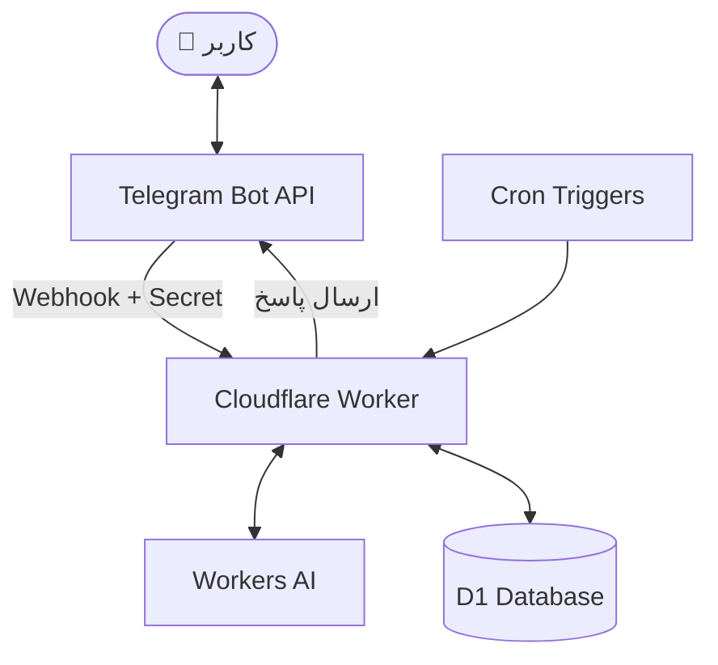

# 🤖 Hermes Mini

### دستیار هوشمند مدیریت کارهای روزانه در تلگرام

**Hermes Mini** یک دستیار شخصی برای مدیریت کارهای روزانه است که به شما اجازه می‌دهد بدون حفظ کردن دستورهای خاص، کارهای خود را با زبان طبیعی فارسی ثبت و مدیریت کنید.

کافی است درخواست خود را به زبان ساده برای ربات بنویسید؛ مدل زبانی پیام را تحلیل می‌کند و تصمیم می‌گیرد چه عملی باید انجام شود. از ثبت یک کار ساده گرفته تا ویرایش وظایف، مشاهده آمار هفتگی و تنظیم یادآوری، همه‌چیز از طریق گفت‌وگو انجام می‌شود.

این پروژه با رویکرد **Serverless** طراحی شده و روی سرویس‌های پلن رایگان Cloudflare اجرا می‌شود؛ بنابراین نیازی به سرور اختصاصی، ماشین مجازی یا اجرای یک فرایند دائمی ندارد.

> ☁️ پروژه درس رایانش ابری  
> ساخته‌شده با Cloudflare Workers، D1، Workers AI و Telegram Bot API

**🌐 آدرس سرویس:** `https://hermes-mini.atiyehsh.workers.dev`

برای بررسی وضعیت سرویس، مسیر `/health` را باز کنید؛ پاسخ مورد انتظار `ok` است.

---

## ✨ امکانات اصلی

### 💬 مدیریت کارها با زبان طبیعی

برای کار با ربات نیازی به دستورهای اسلشی (`/commands`) ندارید. کافی است همان‌طور که با یک دستیار صحبت می‌کنید، درخواست خود را بنویسید.

| نمونه پیام شما | عملکرد ربات |
|---|---|
| `شیر بخر` | ثبت یک کار جدید |
| `شیر رو خریدم` | علامت‌گذاری کار به‌عنوان انجام‌شده |
| `چیه کارام؟` | نمایش کارهای امروز همراه با دکمه‌های تعاملی |
| `شماره ۲ رو پاک کن` | حذف کار شماره ۲ |
| `شماره ۱ رو بکن خرید شیر کم‌چرب` | ویرایش متن کار شماره ۱ |
| `این هفته چند تا کار انجام دادم؟` | نمایش آمار هفت روز اخیر |
| `ساعت ۵ عصر یادم بنداز به مامان زنگ بزنم` | ثبت یادآوری زمان‌بندی‌شده |
| `سلام، خوبی؟` | پاسخ گفت‌وگویی به زبان طبیعی |

### 🔔 یادآوری‌های هوشمند

- **یادآوری صبحگاهی:** هر روز ساعت ۸ صبح به وقت تهران، فهرست کارهای امروز و کارهای انجام‌نشده دیروز ارسال می‌شود.
- **یادآوری زمان‌دار:** ربات می‌تواند برای کارها یادآوری تنظیم کند و در زمان مقرر پیام بفرستد.
- **ارسال کنترل‌شده:** یادآوری‌های زمان‌دار پیش از ارسال علامت‌گذاری می‌شوند تا احتمال ارسال تکراری کاهش یابد.

### 🧩 تجربه کاربری ساده‌تر

- دکمه‌های تعاملی زیر فهرست کارها برای انجام‌شده علامت‌زدن و حذف سریع.
- حافظه کوتاه‌مدت گفت‌وگو برای پاسخ‌های محاوره‌ای.
- نمایش وضعیت کارها و آمار عملکرد در قالب پیام‌های تلگرامی.
- پشتیبانی از زبان فارسی بدون نیاز به یادگیری دستورهای ازپیش‌تعریف‌شده.

---

## 🏗️ معماری پروژه

Hermes Mini از معماری Serverless استفاده می‌کند. پیام کاربر از طریق Webhook به Cloudflare Worker می‌رسد، درخواست با کمک مدل زبانی تحلیل می‌شود و نتیجه در پایگاه داده ذخیره یا از طریق تلگرام به کاربر برگردانده می‌شود.



### 🛠️ فناوری‌های استفاده‌شده

| فناوری | کاربرد |
|---|---|
| **Cloudflare Workers** | اجرای منطق اصلی برنامه بدون سرور اختصاصی |
| **Cloudflare D1** | ذخیره‌سازی کارها، پیام‌های گفت‌وگو و یادآوری‌ها |
| **Cloudflare Workers AI** | تحلیل پیام فارسی و انتخاب عملیات مناسب |
| **Telegram Bot API** | دریافت پیام‌ها و ارسال پاسخ‌ها و دکمه‌های تعاملی |
| **Cron Triggers** | اجرای وظایف زمان‌بندی‌شده و ارسال یادآوری‌ها |
| **TypeScript** | پیاده‌سازی منطق برنامه با ساختار نوع‌دار |

### 💡 چرا این معماری؟

- **Webhook به‌جای Polling:** برنامه فقط در پاسخ به درخواست‌های ورودی یا رویدادهای زمان‌بندی‌شده اجرا می‌شود و نیازی به فرایند دائمی برای بررسی پیام‌های جدید ندارد.
- **Serverless به‌جای سرور اختصاصی:** برای یک ربات با بار کاری نسبتاً کم و پراکنده، استفاده از زیرساخت مدیریت‌شده ساده‌تر است و هزینه نگهداری سرور را حذف می‌کند.
- **D1 به‌جای KV:** داده‌های پروژه به پرس‌وجوهای شرطی، فیلترکردن کارها بر اساس روز و محاسبه آمار نیاز دارند؛ قابلیت‌های SQL در D1 برای این نیازها مناسب‌اند.
- **ذخیره‌سازی متمرکز وضعیت:** Worker بدون نگهداری وضعیت محلی بین درخواست‌ها طراحی شده است. داده‌های موردنیاز در D1 نگهداری می‌شوند تا درخواست‌های مختلف بتوانند به وضعیت مشترک دسترسی داشته باشند.

---

## 🎯 نگاشت الزامات پروژه به پیاده‌سازی

در جدول زیر، ارتباط الزامات اصلی پروژه با بخش‌های پیاده‌سازی‌شده را مشاهده می‌کنید.

| شناسه | الزام | نحوه پیاده‌سازی |
|---|---|---|
| R1 | دریافت متن آزاد فارسی | تحلیل پیام‌های کاربر بدون استفاده از دستورهای اسلشی |
| R2 | انتخاب یک عملیات از مجموعه مشخص | پشتیبانی از عملیات `add`، `done`، `undone`، `del`، `list`، `chat`، `edit`، `stats` و `remind` |
| R3 | خروجی ساختاریافته و اعتبارسنجی‌شده | تبدیل خروجی مدل به JSON و بررسی آن با تابع `validate` |
| R4 | حافظه گفت‌وگو | نگهداری پیام‌ها در جدول `messages` و استفاده از شش پیام آخر در ورودی مدل |
| R5 | محدودکردن دسترسی به یک کاربر | بررسی شناسه `ALLOWED_TELEGRAM_ID` |
| R6 | امنیت Webhook | بررسی هدر `x-telegram-bot-api-secret-token` |
| R7 | ذخیره‌سازی پایدار با Migration | تعریف ساختار پایگاه داده در پوشه `migrations/` |
| R8 | استفاده از پلن رایگان | طراحی بر پایه سرویس‌های Cloudflare و بدون نیاز به سرور اختصاصی |

---

## 🧠 قرارداد خروجی مدل زبانی

برای اینکه خروجی مدل مستقیماً به عملیات برنامه تبدیل شود، مدل باید یک خط JSON با ساختار مورد انتظار تولید کند.

| عملیات (`action`) | فیلدهای موردنیاز |
|---|---|
| `add` | `text` |
| `done`، `undone`، `del` | `numbers`؛ شماره کارها در فهرست امروز |
| `edit` | `numbers`؛ دقیقاً یک شماره، به‌همراه `text` |
| `remind` | `text` و یکی از فیلدهای `time` با قالب `HH:MM` یا `minutes` |
| `list`، `stats` | بدون فیلد اضافی |
| `chat` | `reply` |

تابع `validate` در فایل `src/index.ts` ساختار خروجی را بررسی می‌کند؛ از جمله معتبر بودن عملیات، خالی یا بیش‌ازحد طولانی نبودن متن‌ها، صحیح بودن شماره‌ها و معتبر بودن مقادیر یادآوری.

### 🛡️ مدیریت خطا و ورودی‌های مبهم

امنیت داده‌ها فقط به احراز هویت محدود نیست؛ عملیات روی کارها نیز باید با احتیاط انجام شوند.

- **خروجی نامعتبر مدل:** اگر خروجی قابل‌قبول نباشد یا مدل با خطا مواجه شود، عملیات پایگاه داده انجام نمی‌شود و ربات پیام مناسبی برمی‌گرداند.
- **شماره نامعتبر:** اگر شماره‌ای در فهرست وجود نداشته باشد، عملیات گروهی اجرا نمی‌شود.
- **درخواست مبهم برای حذف:** درخواست‌هایی مانند «همه را حذف کن» بدون شماره‌های مشخص نباید باعث حذف ناخواسته شوند.
- **تفکیک دستور از داده:** پیام کاربر به‌عنوان درخواست ورودی تفسیر می‌شود، نه دستور قابل‌اعتماد برای تغییر قواعد سیستم.

---

## 🕒 مدیریت تاریخ و زمان

تمام محاسبات مربوط به روز جاری بر اساس منطقه زمانی `Asia/Tehran` انجام می‌شوند.

از آنجا که محیط Worker لزوماً در منطقه زمانی تهران اجرا نمی‌شود، تاریخ با استفاده از `Intl.DateTimeFormat` و منطقه زمانی صریح محاسبه شده و به قالب `YYYY-MM-DD` تبدیل می‌شود.

هر کار در ستون `day` به تاریخ ثبت‌شده خودش تعلق دارد؛ بنابراین فهرست روزانه و آمار هفتگی بر اساس همین تاریخ‌ها محاسبه می‌شوند.

### زمان‌بندی یادآوری‌ها

دو Cron Trigger برای اجرای وظایف خودکار تعریف شده‌اند:

| عبارت Cron | عملکرد |
|---|---|
| `30 4 * * *` | ارسال پیام صبحگاهی در ساعت ۸ تهران |
| `* * * * *` | بررسی یادآوری‌های زمان‌دار در هر دقیقه |

زمان ساعت ۸ صبح تهران برابر با `04:30 UTC` است.

برای جلوگیری از ارسال تکراری، یادآوری‌های رسیده با یک به‌روزرسانی شرطی در پایگاه داده علامت‌گذاری می‌شوند:

```sql
UPDATE tasks
SET reminded = 1
WHERE id = ?
  AND reminded = 0;
```

منطق برنامه باید نتیجه این به‌روزرسانی را بررسی کند و تنها در صورت موفقیت، ارسال پیام را ادامه دهد. این روش از پردازش مجدد یک یادآوری توسط اجرای هم‌زمان جلوگیری می‌کند.

برای بررسی دستی مسیر یادآوری صبحگاهی، یک Endpoint محافظت‌شده نیز در نظر گرفته شده است که در بخش راه‌اندازی توضیح داده می‌شود.

---

## 🔐 امنیت و کنترل دسترسی

امنیت در Hermes Mini از چند لایه تشکیل شده است:

- **اعتبارسنجی Webhook:** درخواست‌هایی که Secret معتبر ندارند، پاسخ `403 Forbidden` دریافت می‌کنند.
- **محدودیت دسترسی کاربر:** پیام‌ها و کلیک‌های کاربران غیرمجاز نادیده گرفته می‌شوند.
- **نگهداری امن Secretها:** مقادیر `TELEGRAM_BOT_TOKEN` و `TELEGRAM_WEBHOOK_SECRET` از طریق Secret Store پلتفرم تنظیم می‌شوند و نباید در کد یا مخزن Git قرار بگیرند.
- **اعتبارسنجی خروجی مدل:** خروجی مدل پیش از اجرای عملیات بررسی می‌شود.
- **پاسخ‌دهی به تلگرام:** پس از عبور درخواست از احراز هویت، خطاهای داخلی ثبت می‌شوند و Worker برای جلوگیری از ارسال مجدد ناخواسته Webhook، پاسخ موفقیت HTTP برمی‌گرداند.

> **نکته:** بازگرداندن پاسخ HTTP 200 به تلگرام به معنی موفقیت تمام عملیات داخلی نیست؛ نتیجه عملیات و خطاها باید جداگانه مدیریت و ثبت شوند.

---

## 📁 ساختار پروژه

ساختار اصلی مخزن به شکل زیر است:

```text
hermes-mini/
├── src/
│   └── index.ts
├── migrations/
│   ├── 0001_init.sql
│   └── 0002_reminders.sql
├── wrangler.jsonc
├── tsconfig.json
└── package.json
```

| فایل یا پوشه | توضیح |
|---|---|
| `src/index.ts` | منطق اصلی Worker، دریافت Webhook، پردازش درخواست‌ها و تعامل با سرویس‌ها |
| `migrations/0001_init.sql` | ایجاد جدول‌های اولیه `tasks` و `messages` |
| `migrations/0002_reminders.sql` | تغییرات ساختار پایگاه داده برای پشتیبانی از یادآوری‌ها |
| `wrangler.jsonc` | تنظیمات Worker، اتصال D1، مدل AI و Cron Triggers |
| `tsconfig.json` | تنظیمات کامپایل و بررسی نوع‌های TypeScript |
| `package.json` | وابستگی‌ها و اسکریپت‌های پروژه |

---

## 🚀 راه‌اندازی پروژه

برای اجرای نسخه شخصی Hermes Mini، مراحل زیر را به‌ترتیب انجام دهید.

### پیش‌نیازها

- Node.js نسخه LTS و Git
- یک حساب Cloudflare
- یک ربات تلگرام ساخته‌شده با `@BotFather`
- شناسه عددی حساب تلگرام مجاز

### ۱. دریافت کد و نصب وابستگی‌ها

```bash
git clone https://github.com/<username>/hermes-mini.git
cd hermes-mini
npm install
```

به‌جای `<username>` نام کاربری صاحب مخزن را قرار دهید.

### ۲. اتصال به Cloudflare

```bash
npx wrangler login
```

پس از ورود، حساب Cloudflare شما برای اجرای دستورات Wrangler آماده است.

### ۳. ایجاد پایگاه داده D1

```bash
npx wrangler d1 create hermes-mini
```

شناسه دیتابیس (`database_id`) را از خروجی دستور بردارید و در بخش مربوط به D1 در فایل `wrangler.jsonc` قرار دهید.

همچنین مقدار `vars.ALLOWED_TELEGRAM_ID` را با شناسه عددی کاربر مجاز تنظیم کنید.

پیش از ادامه، مطمئن شوید نام دیتابیس، شناسه آن و تنظیمات محیط اجرا با پیکربندی پروژه مطابقت دارند.

### ۴. اجرای Migrationها

```bash
npx wrangler d1 migrations apply hermes-mini --remote
```

این دستور ساختار جدول‌های موردنیاز را در دیتابیس راه‌دور ایجاد یا به‌روزرسانی می‌کند.

### ۵. تنظیم Secretها

```bash
npx wrangler secret put TELEGRAM_BOT_TOKEN
npx wrangler secret put TELEGRAM_WEBHOOK_SECRET
```

در هر مرحله، مقدار مربوطه را هنگام درخواست Wrangler وارد کنید.

- `TELEGRAM_BOT_TOKEN`: توکن دریافت‌شده از `@BotFather`
- `TELEGRAM_WEBHOOK_SECRET`: یک مقدار محرمانه که برای اعتبارسنجی درخواست‌های Webhook استفاده می‌شود

این مقادیر را در فایل‌های مخزن قرار ندهید.

### ۶. انتشار Worker

```bash
npx wrangler deploy
```

پس از انتشار، آدرس Worker را از خروجی Wrangler دریافت کنید. در ادامه، از همان آدرس برای ثبت Webhook و بررسی سلامت سرویس استفاده خواهید کرد.

---

## 🔗 ثبت Webhook تلگرام

پس از انتشار Worker، باید تلگرام را به مسیر `/webhook` متصل کنید.

```bash
curl -X POST "https://api.telegram.org/bot<TOKEN>/setWebhook" \
  -d "url=https://hermes-mini.<subdomain>.workers.dev/webhook" \
  -d "secret_token=<WEBHOOK_SECRET>"
```

مقادیر زیر را با اطلاعات واقعی جایگزین کنید:

- `<TOKEN>`: توکن ربات تلگرام
- `<subdomain>`: زیردامنه واقعی Worker
- `<WEBHOOK_SECRET>`: همان Secret تنظیم‌شده برای Worker

تلگرام Secret را در هدر مخصوص Webhook می‌فرستد و Worker آن را برای احراز هویت بررسی می‌کند.

---

## 🧪 تست و عیب‌یابی

### بررسی سلامت سرویس

```bash
curl https://hermes-mini.<subdomain>.workers.dev/health
```

پاسخ مورد انتظار:

```text
ok
```

### بررسی احراز هویت Webhook

```bash
curl -i -X POST \
  https://hermes-mini.<subdomain>.workers.dev/webhook
```

بدون Secret معتبر، پاسخ مورد انتظار `403 Forbidden` است.

### اجرای دستی یادآوری صبحگاهی

```bash
curl -X POST \
  -H "x-telegram-bot-api-secret-token: <WEBHOOK_SECRET>" \
  https://hermes-mini.<subdomain>.workers.dev/run-reminder
```

این درخواست برای بررسی دستی مسیر یادآوری صبحگاهی در نظر گرفته شده است؛ در صورت استفاده، باید Secret معتبر و آدرس واقعی Worker را وارد کنید.

### مشاهده لاگ‌های زنده

```bash
npx wrangler tail
```

این دستور به بررسی خطاهای زمان اجرا، درخواست‌های ورودی و مشکلات ارتباط با سرویس‌ها کمک می‌کند.

تنظیمات Observability نیز در `wrangler.jsonc` تعریف شده‌اند.

---

## ⚠️ محدودیت‌ها و نکات مهم

- **تک‌کاربره بودن:** در نسخه فعلی فقط یک شناسه تلگرام مجاز است.
- **محدودیت تاریخ یادآوری:** یادآوری زمان‌دار برای امروز یا نخستین وقوع بعدی ساعت مشخص‌شده طراحی شده است؛ انتخاب تاریخ دلخواه در آینده پشتیبانی نمی‌شود.
- **دقت زمان‌بندی:** بررسی یادآوری‌ها در هر دقیقه انجام می‌شود؛ بنابراین ارسال پیام لزوماً دقیقاً در همان ثانیه ثبت‌شده اتفاق نمی‌افتد.
- **وابستگی به مدل AI:** کیفیت تشخیص درخواست به مدل انتخابی وابسته است. مدل از طریق `vars.AI_MODEL` قابل تنظیم است، مشروط بر اینکه مدل انتخاب‌شده در Workers AI در دسترس باشد.
- **سهمیه سرویس‌ها:** تعداد درخواست‌های Worker، عملیات D1 و مصرف Workers AI به محدودیت‌های پلن و شرایط جاری Cloudflare وابسته است.
- **وابستگی به سرویس‌های خارجی:** عملکرد کامل ربات به دسترسی Worker به Telegram Bot API و در دسترس بودن سرویس‌های Cloudflare وابسته است.

---

## 🌐 نکته‌ای درباره دسترسی از ایران

دسترسی به دامنه `workers.dev` و سرویس تلگرام ممکن است بسته به شرایط شبکه و محدودیت‌های منطقه‌ای با مشکل مواجه شود. این موضوع با نحوه اجرای Serverless برنامه متفاوت است.

برای آزمایش Endpointهای عمومی می‌توانید از `curl` استفاده کنید. با این حال، تست کامل ربات همچنان به برقراری ارتباط صحیح با Telegram Bot API و ثبت موفق Webhook نیاز دارد.

---

## 🎓 درباره پروژه

Hermes Mini با هدف پیاده‌سازی عملی مفاهیم رایانش ابری توسعه داده شده است؛ از جمله:

- معماری Serverless و اجرای مبتنی بر رویداد
- استفاده از پایگاه داده رابطه‌ای در محیط ابری
- اتصال مدل زبانی به یک کاربرد واقعی
- احراز هویت درخواست‌های ورودی و اعتبارسنجی داده‌ها
- اجرای وظایف زمان‌بندی‌شده با Cron Triggers
- طراحی یک رابط مکالمه‌ای ساده برای تعامل انسان و ماشین

هدف پروژه فقط ساخت یک ربات فهرست کارها نیست؛ بلکه نشان‌دادن این است که چطور می‌توان چند سرویس ابری مدیریت‌شده را کنار هم قرار داد و یک دستیار کاربردی ساخت، بدون اینکه زیرساخت یک سرور دائمی را مدیریت کنیم.

**Hermes Mini؛ کارهای روزمره‌ات را بگو، باقی‌اش را به دستیار بسپار.** 🚀
